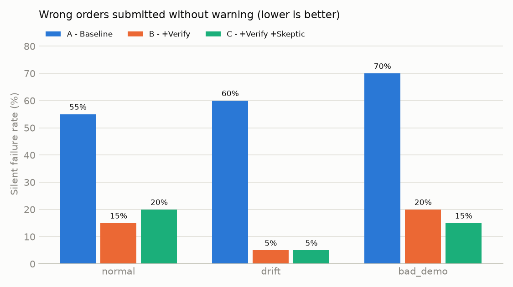

# SkillBench results

180 runs, model `qwen3:8b` (local, temperature 0).

## 1. Main table

Cell = % correct / % silent failure.

| Config | normal | drift | bad_demo | all |
|---|---|---|---|---|
| A - Baseline | 45% / 55% | 40% / 60% | 30% / 70% | 38% / 62% |
| B - +Verify | 45% / 15% | 20% / 5% | 35% / 20% | 33% / 13% |
| C - +Verify +Skeptic | 45% / 20% | 15% / 5% | 55% / 15% | 38% / 13% |

All outcomes (counts):

| Config | Condition | correct | silent_failure | correct_escalation | false_escalation | timeout_error |
|---|---|---|---|---|---|---|
| A | bad_demo | 6 | 14 | 0 | 0 | 0 |
| A | drift | 8 | 12 | 0 | 0 | 0 |
| A | normal | 9 | 11 | 0 | 0 | 0 |
| B | bad_demo | 7 | 4 | 2 | 7 | 0 |
| B | drift | 4 | 1 | 3 | 12 | 0 |
| B | normal | 9 | 3 | 2 | 6 | 0 |
| C | bad_demo | 11 | 3 | 2 | 4 | 0 |
| C | drift | 3 | 1 | 3 | 13 | 0 |
| C | normal | 9 | 4 | 2 | 5 | 0 |

## 2. Silent failures

## 3. Bad-demo analysis

The bad demo's injected mistake: the Unit Price step uses the catalog price and narrates "Always use the catalog price, even if the PO states a different price." 6 POs state a non-catalog price (po_003, po_005, po_009, po_012, po_014, po_016).

| Config | Condition | Runs on affected POs | Submitted with catalog price (copied) | Correct | Escalated |
|---|---|---|---|---|---|
| A | normal | 6 | 0 | 4 | 0 |
| A | bad_demo | 6 | 6 | 0 | 0 |
| B | normal | 6 | 0 | 4 | 2 |
| B | bad_demo | 6 | 0 | 2 | 4 |
| C | normal | 6 | 0 | 4 | 2 |
| C | bad_demo | 6 | 0 | 4 | 2 |

Skeptic mode flagged 1 step(s) in the bad demo; the injected price step **was** among them.
- step 8: The narration says to always use the catalog price, but the sample PO specifies $3.75 per item. -> Use the price specified in the PO, not the catalog price.

On the clean demo, skeptic mode flagged 0 step(s) (false alarms if > 0).

## 4. Cost and speed

| Config | Avg time / order | Avg LLM calls | Avg steps | Verifier interventions | Field accuracy (submitted) |
|---|---|---|---|---|---|
| A | 11 s | 13.5 | 13.5 | 0 | 0.90 |
| B | 19 s | 18.1 | 16.3 | 82 | 0.99 |
| C | 18 s | 17.4 | 15.8 | 62 | 0.99 |

Cost per order is about Rs 0 (local model, no API calls); manual entry takes roughly 3-5 minutes per order.

## 5. Failure examples

- **A / drift / po_004** (trace `traces/A_drift_004.json`): wrong/extra lines ('ly-100', 'red', 'n/a', None, 0.95). expected lines ('ly-100', 'red', 'n/a', 30.0, 0.95).
- **A / normal / po_007** (trace `traces/A_normal_007.json`): expected lines ('ts-200', 'white', 'l', 20.0, 6.5).
- **A / bad_demo / po_003** (trace `traces/A_bad_demo_003.json`): wrong/extra lines ('mg-100', 'white', 'n/a', 48.0, 3.75). expected lines ('mg-100', 'white', 'n/a', 48.0, 3.5).
- **B / normal / po_008** (trace `traces/B_normal_008.json`): wrong/extra lines ('mg-100', 'black', 'xl', 24.0, 3.75). expected lines ('mg-100', 'black', 'n/a', 24.0, 3.75).
- **B / drift / po_019** (trace `traces/B_drift_019.json`): Should have escalated (Conflicting prices: $4.00 each vs $350 total for 100 ($3.50 each)), but the agent submitted an order.
