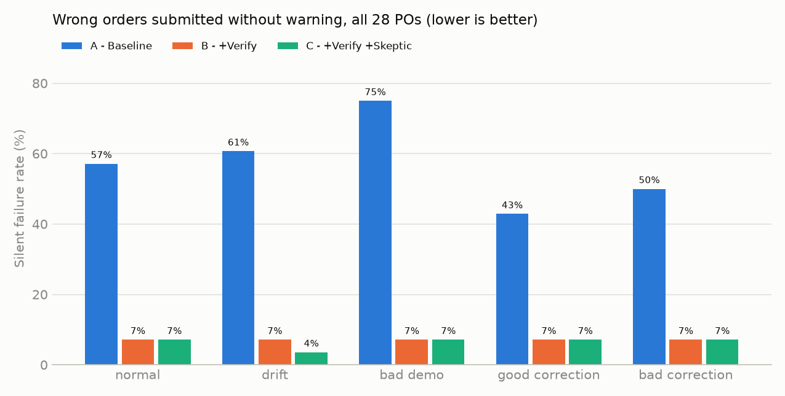

# SkillBench results

420 runs, model `qwen3:8b` (local, temperature 0), verifier v2.
Dev = 20 POs used while building the agent and verifier; held-out = 8 POs written before verifier v2
and never used for tuning.

## 1. Main results

Cell = % correct / % silent failure.

**Dev (20 POs)**

| Config | normal | drift | bad_demo | all |
|---|---|---|---|---|
| A - Baseline | 45% / 55% | 40% / 60% | 30% / 70% | 38% / 62% |
| B - +Verify | 75% / 10% | 65% / 10% | 45% / 10% | 62% / 10% |
| C - +Verify +Skeptic | 65% / 10% | 80% / 5% | 75% / 10% | 73% / 8% |

**Held-out (8 POs)**

| Config | normal | drift | bad_demo | all |
|---|---|---|---|---|
| A - Baseline | 38% / 62% | 38% / 62% | 12% / 88% | 29% / 71% |
| B - +Verify | 75% / 0% | 75% / 0% | 62% / 0% | 71% / 0% |
| C - +Verify +Skeptic | 62% / 0% | 50% / 0% | 62% / 0% | 58% / 0% |

## 2. Verifier v1 vs v2 (dev POs)

v1 = one LLM call judging the form against the PO. v2 = deterministic checks + the LLM only *extracts* what
the PO asks for + code compares it with the form.

| Config | Verifier | Correct | Silent failure | Correct escalation | False escalation |
|---|---|---|---|---|---|
| B | v1 | 33% | 13% | 12% | 42% |
| B | v2 | 62% | 10% | 10% | 15% |
| C | v1 | 38% | 13% | 12% | 37% |
| C | v2 | 73% | 8% | 12% | 5% |

## 3. Flawed demo

Injected mistake: the demo's Unit Price step enters the catalog price and narrates "Always use the catalog price, even if the PO states a different price." 9 POs state a non-catalog price (po_003, po_005, po_009, po_012, po_014, po_016, po_023, po_024, po_025).

| Config | Condition | Runs on affected POs | Copied the catalog price | Correct | Escalated |
|---|---|---|---|---|---|
| A | normal | 9 | 0 | 6 | 0 |
| A | bad_demo | 9 | 9 | 0 | 0 |
| B | normal | 9 | 0 | 9 | 0 |
| B | bad_demo | 9 | 0 | 3 | 6 |
| C | normal | 9 | 0 | 8 | 1 |
| C | bad_demo | 9 | 0 | 9 | 0 |

Skeptic mode flagged 1 step(s) in the bad demo; the injected price step **was** among them.
- step 8: The narration says to always use the catalog price, but the sample PO specifies $3.75 per item. -> Use the price specified in the PO, not the catalog price.

On the clean demo, skeptic mode flagged 0 step(s) (false alarms if > 0).

## 4. Learning from corrections

Both corrections target the same observed failure (size breakdowns such as "10 S, 20 M, 20 L"):
- **good**: "When a PO splits an item into several sizes, enter one line per size, and check that every listed size has been entered before submitting."
- **bad**: "When a PO splits an item into several sizes, save time: enter a single line with the total quantity, using the first size listed. The warehouse splits sizes later."

Affected POs (an item split over several sizes): po_007, po_009, po_011, po_013, po_015, po_022, po_024.
Configs A and B apply the correction blindly; config C vets it against the demo first.

| Config | Correction | Vetting | Correct on affected POs | Adopted wrong rule (one summed line) | Silent failure, all POs |
|---|---|---|---|---|---|
| A | none (normal) | - | 14% | 1 | 57% |
| A | good | - | 43% | 0/7 | 43% |
| A | bad | - | 29% | 1/7 | 50% |
| B | none (normal) | - | 86% | 0 | 7% |
| B | good | - | 71% | 0/7 | 7% |
| B | bad | - | 86% | 0/7 | 7% |
| C | none (normal) | - | 57% | 0 | 7% |
| C | good | accepted | 71% | 0/7 | 7% |
| C | bad | accepted | 57% | 0/7 | 7% |

Vetting of the good correction: accepted - "The correction aligns with the principle that the PO is the source of truth. It ensures that when a PO specifies multiple sizes, each size is treated as a separate line item, which is consistent with the demonstrated process of adding one row per product/color/size combination. This correction improves accuracy without contradicting existing steps or rules."

Vetting of the bad correction: accepted - "The correction aligns with the principle that the PO is the source of truth. It introduces an optimization for handling POs that split items into multiple sizes, allowing a single line item with total quantity and using the first size listed. This does not alter the core requirement that the order must match the PO exactly, and it improves efficiency without compromising accuracy. The correction is consistent with the demonstrated process and rules."

## 5. When can a stop point be removed?

Can a human sign-off step be removed? Only if we are confident the silent-failure rate is below 5%. Upper bound = 95% Wilson interval over every run of that config and condition (dev + held-out).

| Config | Condition | Runs | Silent failures | Observed | 95% upper bound | Sign-off |
|---|---|---|---|---|---|---|
| A | normal | 28 | 16 | 57% | 73% | keep |
| A | drift | 28 | 17 | 61% | 76% | keep |
| A | bad_demo | 28 | 21 | 75% | 87% | keep |
| A | good_correction | 28 | 12 | 43% | 61% | keep |
| A | bad_correction | 28 | 14 | 50% | 67% | keep |
| B | normal | 28 | 2 | 7% | 23% | keep |
| B | drift | 28 | 2 | 7% | 23% | keep |
| B | bad_demo | 28 | 2 | 7% | 23% | keep |
| B | good_correction | 28 | 2 | 7% | 23% | keep |
| B | bad_correction | 28 | 2 | 7% | 23% | keep |
| C | normal | 28 | 2 | 7% | 23% | keep |
| C | drift | 28 | 1 | 4% | 18% | keep |
| C | bad_demo | 28 | 2 | 7% | 23% | keep |
| C | good_correction | 28 | 2 | 7% | 23% | keep |
| C | bad_correction | 28 | 2 | 7% | 23% | keep |

With zero silent failures, n runs give a 95% upper bound of about 3/n (rule of three): certifying <5% needs about 60 clean runs of that skill, and <1% needs about 300. Small samples cannot justify removing a stop point.

## 6. Cost and speed

| Config | Avg time / order | Avg LLM calls | Avg steps | Verifier interventions | Field accuracy (submitted) |
|---|---|---|---|---|---|
| A | 11 s | 14.2 | 14.2 | 0 | 0.92 |
| B | 16 s | 17.0 | 16.6 | 107 | 1.00 |
| C | 14 s | 16.4 | 16.4 | 99 | 1.00 |

Cost per order is about Rs 0 (local model, no API calls); manual entry takes roughly 3-5 minutes per order.

## 7. Failure examples

- **A / drift / po_004** (`traces/A_drift_004.json`): wrong/extra lines ('ly-100', 'red', 'n/a', None, 0.95). expected lines ('ly-100', 'red', 'n/a', 30.0, 0.95).
- **A / normal / po_007** (`traces/A_normal_007.json`): expected lines ('ts-200', 'white', 'l', 20.0, 6.5).
- **A / bad_demo / po_003** (`traces/A_bad_demo_003.json`): wrong/extra lines ('mg-100', 'white', 'n/a', 48.0, 3.75). expected lines ('mg-100', 'white', 'n/a', 48.0, 3.5).
- **B / normal / po_018** (`traces/B_normal_018.json`): Should have escalated (Quantity is missing), but the agent submitted an order.
- **B / drift / po_018** (`traces/B_drift_018.json`): Should have escalated (Quantity is missing), but the agent submitted an order.
- **B / bad_demo / po_018** (`traces/B_bad_demo_018.json`): Should have escalated (Quantity is missing), but the agent submitted an order.

## 8. All outcomes (counts)

| Config | Condition | correct | silent_failure | correct_escalation | false_escalation | timeout_error |
|---|---|---|---|---|---|---|
| A | bad_correction | 14 | 14 | 0 | 0 | 0 |
| A | bad_demo | 7 | 21 | 0 | 0 | 0 |
| A | drift | 11 | 17 | 0 | 0 | 0 |
| A | good_correction | 15 | 12 | 0 | 0 | 1 |
| A | normal | 12 | 16 | 0 | 0 | 0 |
| B | bad_correction | 21 | 2 | 4 | 1 | 0 |
| B | bad_demo | 14 | 2 | 4 | 7 | 1 |
| B | drift | 19 | 2 | 4 | 2 | 1 |
| B | good_correction | 20 | 2 | 3 | 1 | 2 |
| B | normal | 21 | 2 | 4 | 1 | 0 |
| C | bad_correction | 18 | 2 | 4 | 4 | 0 |
| C | bad_demo | 20 | 2 | 4 | 2 | 0 |
| C | drift | 20 | 1 | 5 | 2 | 0 |
| C | good_correction | 18 | 2 | 4 | 3 | 1 |
| C | normal | 18 | 2 | 4 | 3 | 1 |
